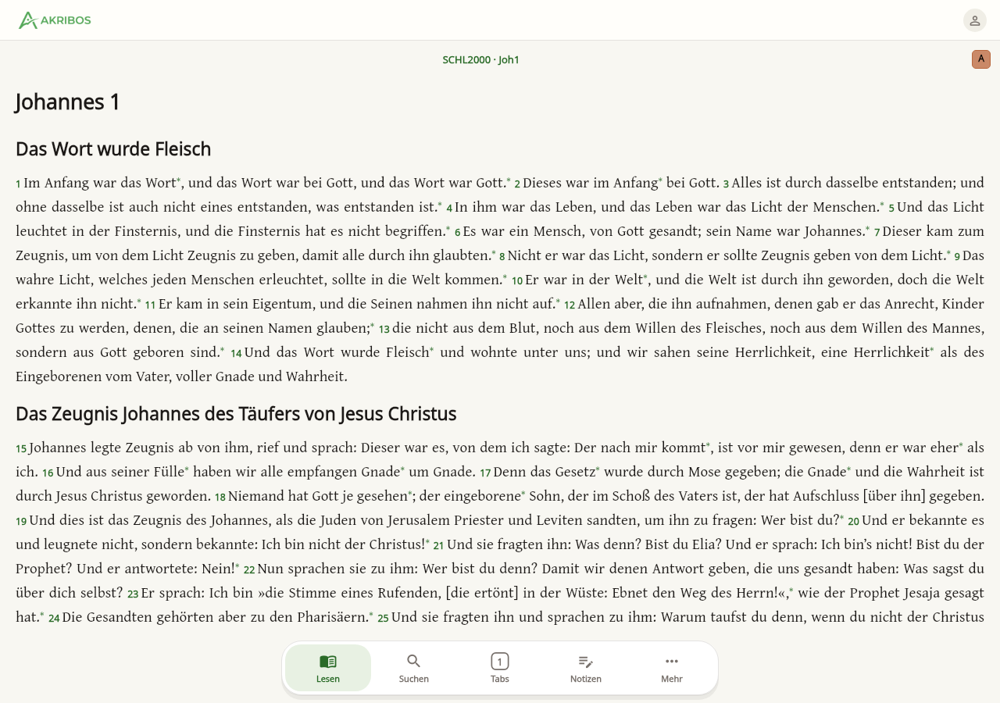

# Akribos für Android und iOS

Native Flutter-App für das persönliche Bibelstudium auf Smartphones und Tablets,
einschließlich eines E-Ink-Modus für Android-Geräte wie Boox. Das Repository enthält
ausschließlich Android- und iOS-Projekte. Verwaltungsfunktionen und Ressourcenimporte
bleiben in der Webverwaltung. Vorerst wird ausschließlich Android veröffentlicht;
die Apple-Organisationsanmeldung läuft noch. iOS-Signierung, App-Links und Gerätefreigabe
folgen nach Bestätigung des Developer-Kontos.

Die normale App verbindet sich direkt über HTTPS mit **https://akribos.de**.
Lesen ist ohne API-Schlüssel möglich; persönliche Funktionen verwenden die normale
Akribos-Anmeldung per E-Mail-Code oder Passwort mit System-Autofill. Gültige Sitzungen
bleiben bei regulären App-Updates und Neustarts erhalten. Dafür sind weder ein lokaler Server
noch eine USB-Verbindung oder ADB erforderlich. Eine Internetverbindung wird benötigt.
Das öffentliche App-Protokoll v1 ist auf akribos.de bereitgestellt; der bestätigte
Prüfstand steht in [docs/VALIDATION.md](docs/VALIDATION.md).

## Android-APK für akribos.de

Mit der unten beschriebenen Flutter-/Android-Buildumgebung:

```sh
./scripts/build-android-production.sh
```

Das Skript baut fest für `https://akribos.de`, Android ARM64 und Version `0.2.7+10` als optimierten AOT-Release.
Die installierbare Datei liegt unter
`artifacts/akribos-0.2.7-akribos-de-release.apk`; daneben liegt ihre SHA-256-Prüfsumme.
Sie kann auf dem Pixel als APK geöffnet und installiert werden. Eine bereits installierte
App mit derselben Android-Debug-Signatur lässt sich damit aktualisieren.
Die APK verwendet zur Update-Kompatibilität den bereits vorhandenen lokalen
Android-Debug-Signierschlüssel. Der App-Code selbst ist ein optimierter, nicht debugbarer
Release-Build. Das Skript prüft den Signaturfingerabdruck und erzeugt keinen neuen Schlüssel.
Sie ist für den direkten Betrieb mit akribos.de bestimmt und keine Google-Play-Veröffentlichung.

Der vorbereitete GitHub-Workflow veröffentlicht signierte Android App Bundles nach
Google Play Internal Testing. Die konkrete Einrichtung einschließlich erstem manuellem
Upload steht in [docs/PLAY-STORE.md](docs/PLAY-STORE.md). Storezugang und Uploadschlüssel
müssen noch eingerichtet werden; die Pixel-APK bleibt davon unabhängig.

## Funktionen

- Bibeln, Kommentare, Lexika und Parallelstellen mit einer flachen Ressourcen-Tabansicht,
  gekoppelten Stellen und lokal gespeicherten Tabs pro Gerät und Konto.
- Wort-/Phrasensuche im aktuellen Werk, Strong-Nummern, Morphologie,
  Übersetzungsstatistik und Fundstellen.
- Vers- und Wortmarkierungen, sichtbare Markierungsfarben, Sammlungen und persönliche Notizen.
- Dokumente mit nativem Richtexteditor, Formatierung an der Textauswahl, Lesen/Bearbeiten,
  Markdown-Speicherung, Autosave und Konfliktauflösung sowie
  lokalen Wiederherstellungsentwürfen, Anhängen und Export.
- Ausarbeitungsboard mit vorhandenen Spalten und verschiebbaren Dokumenten,
  Schlagwörtern, Bibelstellen und Durchführungshistorie.
- Gemeinsame Sammlungen, Mitglieder, Einladungen, Kommentare, Antworten und Reaktionen.
- E-Mail-/Passwortanmeldung, Kontoeinstellungen und persönliche API-Schlüssel.

Die schwebende Hauptnavigation hat Abstand zu den Bildschirmrändern. Lesen, Suche und
Notizen behalten beim Wechsel ihren Zustand. „Tabs“ oder ein erneuter Tipp auf „Lesen“
öffnet die visuelle Ressourcenübersicht nach dem Bedienmuster von Logos Mobile. Auf Telefonen
und Tablets wechseln Wischgesten zwischen allen geöffneten Werken in einer einzigen Tabfolge.
Tabs, Lesestellen und Suchen werden auf diesem Gerät gespeichert, getrennt nach Konto und
Server. Sie sind unabhängig vom Browser und von anderen App-Geräten; eine Verwaltung
benannter Arbeitsbereiche sowie Split- oder Layoutbedienung gibt es in der App nicht.
E-Ink bietet Schwarz-Weiß-Kontrast,
reduzierte Animationen und seitenweises Blättern. Die vollständige Zuordnung und
bewusste Unterschiede zur Weboberfläche stehen in [docs/FEATURES.md](docs/FEATURES.md).

Wortklicks öffnen die Wortstudie über dem Bibeltext als herunterwischbaren Dialog;
Zurück oder Schließen führt direkt zur unveränderten Lesestelle. Tabgruppen verwenden
Farben und Buchstaben wie im Web-Portal. Die Notizliste zeigt keine vollständige Tagwolke;
gezielte Tagfilter und die Bearbeitung der Tags bleiben erreichbar.

„Notizen“ öffnet immer die reine Notizbibliothek; Ausarbeitungen sind von dort über einen
eigenen Wechsel erreichbar. Import, Vorlagen und die Verwaltung von Boardspalten sind
nicht Teil der mobilen Oberfläche. Die Werksuche liegt im Tabmenü; neben dem Stellenfeld
steht kein eigener Suchbutton. Beim Öffnen übernimmt die Hauptnavigation „Suche“ das
aktuelle Werk mit Titel und führt einen vorhandenen Suchbegriff bei einem Werkwechsel
erneut aus. Das Werk wird im Reader gewählt.

„Mehr“ enthält unter anderem „Über Akribos“ und einen lokalen Hilfeplatzhalter.
Eine Anleitung für die fertige App steht noch aus; die offenen Aufgaben stehen in
[docs/TODO.md](docs/TODO.md). Die Recherche und die Übertragung auf Akribos stehen in
[docs/MOBILE-DESIGN.md](docs/MOBILE-DESIGN.md).

## Entwicklung

Zielsysteme: Android ab API 24 (Android 7) und iOS/iPadOS ab 15.

Voraussetzungen: Flutter **3.47.0** / Dart **3.13.0**, Android SDK und JDK 17 oder
passende Android-Studio-JBR. Für iOS zusätzlich macOS mit Xcode.

```sh
flutter pub get --enforce-lockfile
flutter run --dart-define=AKRIBOS_SERVER=https://akribos.de
```

`AKRIBOS_SERVER` wird beim Build festgelegt und enthält nur den Server-Origin, keinen
Pfad, Zugangsdaten oder API-Schlüssel. Standard ist `https://akribos.de`. HTTPS ist
verpflichtend; Debug-Builds erlauben zusätzlich lokale Entwicklungsadressen.

```sh
dart format --output=none --set-exit-if-changed lib test
flutter analyze
flutter test test/core/api_client_test.dart
flutter build apk --debug
```

Der optionale echte HTTP-Test benötigt einen **separaten lokalen Server mit eigener
Testdatenbank**, vorbereitet mit dem Akribos-E2E-Seed. Er verändert ausschließlich
dessen Testdaten. Zugangsdaten im Test sind die öffentlichen Seed-Zugangsdaten.

```sh
flutter test test/live_api_test.dart \
  --dart-define=AKRIBOS_TEST_SERVER=http://127.0.0.1:4176
```

Dieser optionale Testserver ist ausschließlich eine Entwicklungsumgebung. Das oben
beschriebene Produktions-Buildskript verwendet immer akribos.de und übernimmt weder
diese Testadresse noch `AKRIBOS_TEST_SERVER` in die APK.

Die CI prüft Formatierung, Analyse und Tests, baut eine Android-Debug-APK und auf
macOS einen unsignierten iOS-Build. Sie veröffentlicht keine Store-Version.
[docs/RELEASE.md](docs/RELEASE.md) beschreibt Signierung und Geräteabnahme.

## Architektur und Datenschutz

Die Oberfläche besteht aus Flutter-Widgets. Sichere strukturierte Bibelsegmente und
serverseitig bereinigter Dokument-/Kommentartext werden nativ gerendert. Es gibt
keine eingebettete WebView und keinen externen Schriftdienst.

Sitzungscookies, lokale Readerstände und persönliche Dokumententwürfe liegen im sicheren
Plattform-Speicher. Readerstände und Entwürfe sind nach Server und Konto getrennt. Die App sendet keine Analyseereignisse. Private Bilder
werden über denselben authentifizierten Client geladen; fremde Bilder nicht automatisch.
Bewusst geöffnete externe Links verwenden den Systembrowser.

Lesen und Synchronisierung benötigen eine Verbindung. Ein vollständiger Offline-
Bibelbestand oder eine allgemeine Warteschlange für Offline-Änderungen ist nicht enthalten.
Konflikte überschreiben keine neuere Dokumentrevision stillschweigend.

Details: [API](docs/API.md), [Architektur](docs/ARCHITECTURE.md),
[Geräteprüfung](docs/RELEASE.md), [aktueller Prüfstand](docs/VALIDATION.md),
[offene Aufgaben](docs/TODO.md).

## Ansichten

Die folgenden Aufnahmen stammen aus echten Flutter-Widgets mit anonym abgerufenen
öffentlichen Readerdaten (Akribos Luther und King James, Johannes 3). Es sind Widget-Aufnahmen,
keine Fotos von Geräten; private Kontodaten werden dafür nicht verwendet.

| Telefon | Geöffnete Tabs | Tablet | E-Ink |
| --- | --- | --- | --- |
|  |  |  |  |

## Lizenz

AGPL-3.0 gemäß [LICENSE](LICENSE). Akribos Text und Noto Sans Hebrew werden lokal mit
ihren OFL-Lizenzen ausgeliefert. Weitere Paketlizenzen sind über „Über Akribos →
Open-Source-Lizenzen“ zugänglich. Nutzungsrechte geladener Ressourcen bestimmt der Server.
