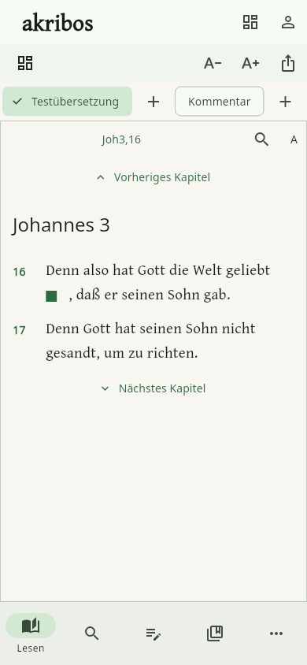
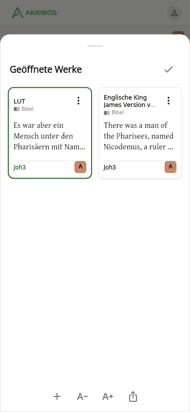

# Akribos für Android und iOS

Native Flutter-App für das persönliche Bibelstudium auf Smartphones und Tablets,
einschließlich eines E-Ink-Modus für Android-Geräte wie Boox. Das Repository enthält
ausschließlich Android- und iOS-Projekte. Verwaltungsfunktionen und Ressourcenimporte
bleiben in der Webverwaltung.

Die normale App verbindet sich direkt über HTTPS mit **https://akribos.de**.
Lesen ist ohne API-Schlüssel möglich; persönliche Funktionen verwenden die normale
Akribos-Anmeldung per E-Mail-Code oder Passwort mit System-Autofill. Gültige Sitzungen
bleiben bei regulären App-Updates und Neustarts erhalten. Dafür sind weder ein lokaler Server
noch eine USB-Verbindung oder ADB erforderlich. Eine Internetverbindung wird benötigt.
Das öffentliche App-Protokoll v1 ist auf akribos.de bereitgestellt; der bestätigte
Prüfstand steht in [docs/VALIDATION.md](docs/VALIDATION.md).

## Android-APK für akribos.de

Mit der unten beschriebenen Flutter-/Android-Buildumgebung:

```sh
./scripts/build-android-production.sh
```

Das Skript baut fest für `https://akribos.de`, Android ARM64 und Version `0.2.3+6` als optimierten AOT-Release.
Die installierbare Datei liegt unter
`artifacts/akribos-0.2.3-akribos-de-release.apk`; daneben liegt ihre SHA-256-Prüfsumme.
Sie kann auf dem Pixel als APK geöffnet und installiert werden. Eine bereits installierte
App mit derselben Android-Debug-Signatur lässt sich damit aktualisieren.
Die APK verwendet zur Update-Kompatibilität den bereits vorhandenen lokalen
Android-Debug-Signierschlüssel. Der App-Code selbst ist ein optimierter, nicht debugbarer
Release-Build. Das Skript prüft den Signaturfingerabdruck und erzeugt keinen neuen Schlüssel.
Sie ist für den direkten Betrieb mit akribos.de bestimmt und keine Google-Play-Veröffentlichung.

## Funktionen

- Bibeln, Kommentare, Lexika und Parallelstellen mit nativen Ressourcen-Tabs,
  acht Arbeitsbereichsanordnungen, gekoppelten Stellen und gespeicherten Ansichten.
- Wort-/Phrasensuche, Strong-Nummern, Morphologie, Übersetzungsstatistik und Fundstellen.
- Vers- und Wortmarkierungen, eigene Farben, Sammlungen und persönliche Notizen.
- Dokumente mit Markdown-Werkzeugleiste, Lesevorschau, Autosave, Konfliktauflösung,
  lokalen Wiederherstellungsentwürfen, Anhängen, Import und Export.
- Ausarbeitungsboard, Vorlagen, Schlagwörter, Bibelstellen und Durchführungshistorie.
- Gemeinsame Sammlungen, Mitglieder, Einladungen, Kommentare, Antworten und Reaktionen.
- E-Mail-/Passwortanmeldung, Kontoeinstellungen, API-Schlüssel und Nutzerhilfe.

Die schwebende Hauptnavigation hat Abstand zu den Bildschirmrändern. Lesen, Suche und
Notizen behalten beim Wechsel ihren Zustand. „Tabs“ oder ein erneuter Tipp auf „Lesen“
öffnet die visuelle Ressourcenübersicht nach dem Bedienmuster von Logos Mobile. Am Telefon
wechseln Wischgesten zwischen geöffneten Werken; optional lassen sich zwei Bereiche teilen.
Tablets zeigen bis zu vier Panes. E-Ink bietet Schwarz-Weiß-Kontrast,
reduzierte Animationen und seitenweises Blättern. Die vollständige Zuordnung und
bewusste Unterschiede zur Weboberfläche stehen in [docs/FEATURES.md](docs/FEATURES.md).

Wortklicks öffnen die Wortstudie über dem Bibeltext als herunterwischbaren Dialog;
Zurück oder Schließen führt direkt zur unveränderten Lesestelle. Tabgruppen verwenden
Farben und Buchstaben wie im Web-Portal. Die Notizliste zeigt keine vollständige Tagwolke;
gezielte Tagfilter und die Bearbeitung der Tags bleiben erreichbar.

Die Recherche und die Übertragung auf Akribos stehen in [docs/MOBILE-DESIGN.md](docs/MOBILE-DESIGN.md).

## Entwicklung

Zielsysteme: Android ab API 24 (Android 7) und iOS/iPadOS ab 15.

Voraussetzungen: Flutter **3.47.0** / Dart **3.13.0**, Android SDK und JDK 17 oder
passende Android-Studio-JBR. Für iOS zusätzlich macOS mit Xcode.

```sh
flutter pub get --enforce-lockfile
flutter run --dart-define=AKRIBOS_SERVER=https://akribos.de
```

`AKRIBOS_SERVER` wird beim Build festgelegt und enthält nur den Server-Origin, keinen
Pfad, Zugangsdaten oder API-Schlüssel. Standard ist `https://akribos.de`. HTTPS ist
verpflichtend; Debug-Builds erlauben zusätzlich lokale Entwicklungsadressen.

```sh
dart format --output=none --set-exit-if-changed lib test
flutter analyze
flutter test test/core/api_client_test.dart
flutter build apk --debug
```

Der optionale echte HTTP-Test benötigt einen **separaten lokalen Server mit eigener
Testdatenbank**, vorbereitet mit dem Akribos-E2E-Seed. Er verändert ausschließlich
dessen Testdaten. Zugangsdaten im Test sind die öffentlichen Seed-Zugangsdaten.

```sh
flutter test test/live_api_test.dart \
  --dart-define=AKRIBOS_TEST_SERVER=http://127.0.0.1:4176
```

Dieser optionale Testserver ist ausschließlich eine Entwicklungsumgebung. Das oben
beschriebene Produktions-Buildskript verwendet immer akribos.de und übernimmt weder
diese Testadresse noch `AKRIBOS_TEST_SERVER` in die APK.

Die CI prüft Formatierung, Analyse und Tests, baut eine Android-Debug-APK und auf
macOS einen unsignierten iOS-Build. Sie veröffentlicht keine Store-Version.
[docs/RELEASE.md](docs/RELEASE.md) beschreibt Signierung und Geräteabnahme.

## Architektur und Datenschutz

Die Oberfläche besteht aus Flutter-Widgets. Sichere strukturierte Bibelsegmente und
serverseitig bereinigter Dokument-/Kommentartext werden nativ gerendert. Es gibt
keine eingebettete WebView und keinen externen Schriftdienst.

Sitzungscookies und persönliche Dokumententwürfe liegen im sicheren Plattform-Speicher,
getrennt nach Server und Konto. Die App sendet keine Analyseereignisse. Private Bilder
werden über denselben authentifizierten Client geladen; fremde Bilder nicht automatisch.
Rechtliche Angaben des jeweiligen Betreibers öffnen sich im Systembrowser.

Lesen und Synchronisierung benötigen eine Verbindung. Ein vollständiger Offline-
Bibelbestand oder eine allgemeine Warteschlange für Offline-Änderungen ist nicht enthalten.
Konflikte überschreiben keine neuere Dokumentrevision stillschweigend.

Details: [API](docs/API.md), [Architektur](docs/ARCHITECTURE.md),
[Geräteprüfung](docs/RELEASE.md), [aktueller Prüfstand](docs/VALIDATION.md).

## Ansichten

Die folgenden Aufnahmen stammen aus echten Flutter-Widgets mit anonym abgerufenen
öffentlichen Readerdaten (Akribos Luther und King James, Johannes 3). Es sind Widget-Aufnahmen,
keine Fotos von Geräten; private Kontodaten werden dafür nicht verwendet.

| Telefon | Geöffnete Tabs | Tablet | E-Ink |
| --- | --- | --- | --- |
|  |  |  |  |

## Lizenz

AGPL-3.0 gemäß [LICENSE](LICENSE). Akribos Text und Noto Sans Hebrew werden lokal mit
ihren OFL-Lizenzen ausgeliefert. Weitere Paketlizenzen sind über „Über Akribos →
Open-Source-Lizenzen“ zugänglich. Nutzungsrechte geladener Ressourcen bestimmt der Server.
