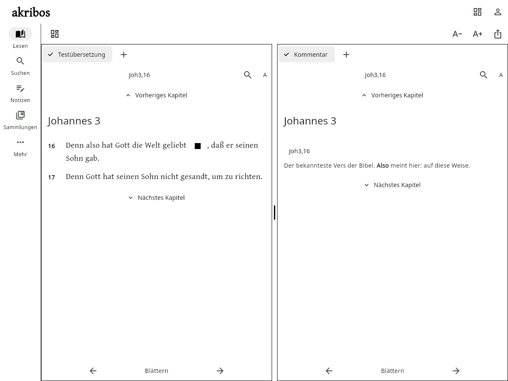

# Akribos für Android und iOS

Native Flutter-App für das persönliche Bibelstudium auf Smartphones und Tablets,
einschließlich eines E-Ink-Modus für Android-Geräte wie Boox. Das Repository enthält
ausschließlich Android- und iOS-Projekte. Verwaltungsfunktionen und Ressourcenimporte
bleiben in der Webverwaltung.

Die App verbindet sich mit einem Akribos-Server mit dem neuen App-Protokoll v1.
Die Änderungen dafür liegen im benachbarten Repository `../akribos`; sie müssen vor
der Verwendung mit einem öffentlichen Server bereitgestellt werden.

## Funktionen

- Bibeln, Kommentare, Lexika und Parallelstellen mit nativen Ressourcen-Tabs,
  acht Arbeitsbereichsanordnungen, gekoppelten Stellen und gespeicherten Ansichten.
- Wort-/Phrasensuche, Strong-Nummern, Morphologie, Übersetzungsstatistik und Fundstellen.
- Vers- und Wortmarkierungen, eigene Farben, Sammlungen und persönliche Notizen.
- Dokumente mit Markdown-Werkzeugleiste, Lesevorschau, Autosave, Konfliktauflösung,
  lokalen Wiederherstellungsentwürfen, Anhängen, Import und Export.
- Ausarbeitungsboard, Vorlagen, Schlagwörter, Bibelstellen und Durchführungshistorie.
- Gemeinsame Sammlungen, Mitglieder, Einladungen, Kommentare, Antworten und Reaktionen.
- E-Mail-/Passwortanmeldung, Kontoeinstellungen, API-Schlüssel und Nutzerhilfe.

Auf dem Telefon werden Ressourcen in einer flachen Tab-Leiste angezeigt; auf dem
Tablet stehen mehrere Kacheln nebeneinander. E-Ink bietet Schwarz-Weiß-Kontrast,
reduzierte Animationen und seitenweises Blättern. Die vollständige Zuordnung und
bewusste Unterschiede zur Weboberfläche stehen in [docs/FEATURES.md](docs/FEATURES.md).

## Entwicklung

Zielsysteme: Android ab API 24 (Android 7) und iOS/iPadOS ab 15.

Voraussetzungen: Flutter **3.47.0** / Dart **3.13.0**, Android SDK und JDK 17 oder
passende Android-Studio-JBR. Für iOS zusätzlich macOS mit Xcode.

```sh
flutter pub get --enforce-lockfile
flutter run --dart-define=AKRIBOS_SERVER=https://akribos.de
```

`AKRIBOS_SERVER` wird beim Build festgelegt und enthält nur den Server-Origin, keinen
Pfad, Zugangsdaten oder API-Schlüssel. Standard ist `https://akribos.de`. HTTPS ist
verpflichtend; Debug-Builds erlauben zusätzlich lokale Entwicklungsadressen.

```sh
dart format --output=none --set-exit-if-changed lib test
flutter analyze
flutter test
flutter build apk --debug
```

Der optionale echte HTTP-Test benötigt einen **separaten lokalen Server mit eigener
Testdatenbank**, vorbereitet mit dem Akribos-E2E-Seed. Er verändert ausschließlich
dessen Testdaten. Zugangsdaten im Test sind die öffentlichen Seed-Zugangsdaten.

```sh
flutter test test/live_api_test.dart \
  --dart-define=AKRIBOS_TEST_SERVER=http://127.0.0.1:4176
```

Für ein über USB verbundenes Android-Gerät kann ein lokaler Server weitergeleitet
werden; die hier gezeigte App bleibt auf diese Verbindung angewiesen:

```sh
adb reverse tcp:4176 tcp:4176
flutter run --dart-define=AKRIBOS_SERVER=http://127.0.0.1:4176
```

Die CI prüft Formatierung, Analyse und Tests, baut eine Android-Debug-APK und auf
macOS einen unsignierten iOS-Build. Sie veröffentlicht keine Store-Version.
[docs/RELEASE.md](docs/RELEASE.md) beschreibt Signierung und Geräteabnahme.

## Architektur und Datenschutz

Die Oberfläche besteht aus Flutter-Widgets. Sichere strukturierte Bibelsegmente und
serverseitig bereinigter Dokument-/Kommentartext werden nativ gerendert. Es gibt
keine eingebettete WebView und keinen externen Schriftdienst.

Sitzungscookies und persönliche Dokumententwürfe liegen im sicheren Plattform-Speicher,
getrennt nach Server und Konto. Die App sendet keine Analyseereignisse. Private Bilder
werden über denselben authentifizierten Client geladen; fremde Bilder nicht automatisch.
Rechtliche Angaben des jeweiligen Betreibers öffnen sich im Systembrowser.

Lesen und Synchronisierung benötigen eine Verbindung. Ein vollständiger Offline-
Bibelbestand oder eine allgemeine Warteschlange für Offline-Änderungen ist nicht enthalten.
Konflikte überschreiben keine neuere Dokumentrevision stillschweigend.

Details: [API](docs/API.md), [Architektur](docs/ARCHITECTURE.md),
[Geräteprüfung](docs/RELEASE.md), [aktueller Prüfstand](docs/VALIDATION.md).

## Ansichten

Die folgenden Aufnahmen stammen aus echten Flutter-Widgets mit anonymen Daten des
lokalen E2E-Seeds. Es sind reproduzierbare Widget-Aufnahmen, keine Fotos von Geräten.

| Telefon | Tablet | E-Ink |
| --- | --- | --- |
|  |  |  |

## Lizenz

AGPL-3.0 gemäß [LICENSE](LICENSE). Akribos Text und Noto Sans Hebrew werden lokal mit
ihren OFL-Lizenzen ausgeliefert. Weitere Paketlizenzen sind über „Über Akribos →
Open-Source-Lizenzen“ zugänglich. Nutzungsrechte geladener Ressourcen bestimmt der Server.
